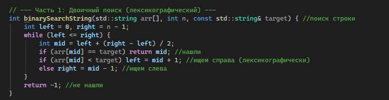
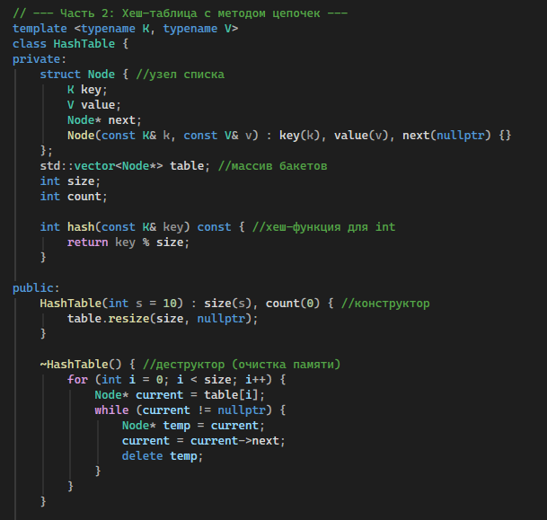
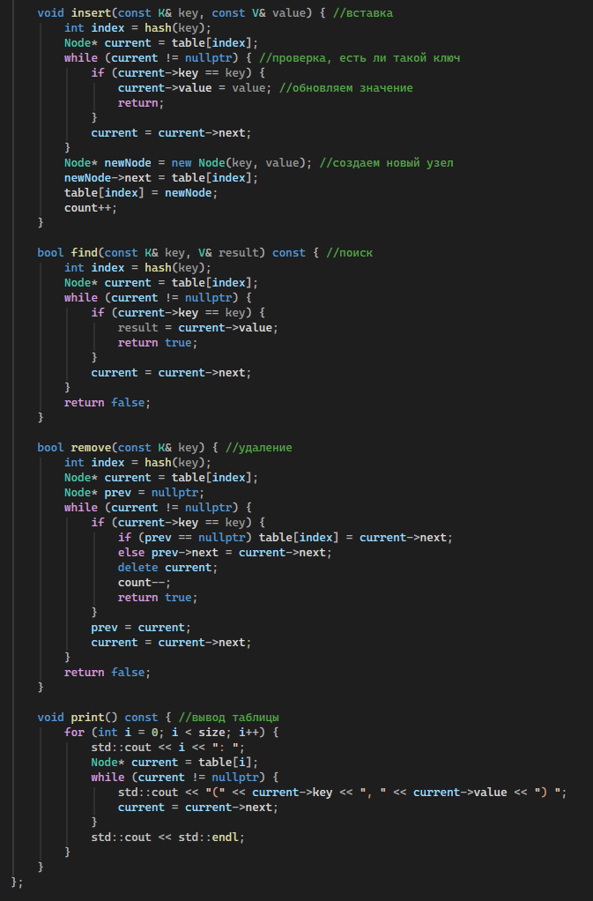

# Отчет к лабораторной работе № 8
# Тема: Двоичный поиск. Хеш-таблицы
# Дисциплина: Алгоритмы и структуры данных
## Выполнил: Бойко Андрей Сергеевич ПИЖ-б-о-25-2
# Цель:
1. Реализовать алгоритм двоичного (бинарного) поиска в отсортированном массиве 
2. Освоить итеративную и рекурсивную реализации двоичного поиска 
3. Изучить понятие хеш-таблицы, хеш-функции и методы разрешения коллизий 
4. Реализовать хеш-таблицу с методом цепочек и открытой адресацией 
5. Сравнить производительность двоичного поиска и хеш-таблицы 
# Ход работы

Реализовал бинарный лексикографический поиск.

Реализовал основные элементы хэш таблицы.

Добавил в класс таблицы функции вставки и вывода.

Написал функцию main для демонстрации работы программы.
# Вывод:
1. Реализовали алгоритм двоичного (бинарного) поиска в отсортированном массиве 
2. Освоили итеративную и рекурсивную реализации двоичного поиска 
3. Изучили понятие хеш-таблицы, хеш-функции и методы разрешения коллизий 
4. Реализовали хеш-таблицу с методом цепочек и открытой адресацией 
5. Сравнили производительность двоичного поиска и хеш-таблицы 
# Ответы на контрольные вопросы:
1 Двоичный поиск - это алгоритм поиска в массиве, который на каждом шаге делит интервал поиска пополам; обязательное условие - массив должен быть предварительно отсортирован.
2 Сложность в лучшем случае - O(1) (если элемент сразу в середине), а в среднем и худшем - O(log n).
3 Итеративная версия использует цикл и требует O(1) памяти, а рекурсивная использует стек вызовов и требует O(log n) памяти.
4 Хеш-таблица - это структура данных для реализации ассоциативного массива (словаря), которая позволяет выполнять вставку, удаление и поиск в среднем за O(1).
5 Хеш-функция преобразует ключ в индекс массива; она должна быть детерминированной, быстро вычисляться и равномерно распределять элементы по таблице.
6 Коллизия - это ситуация, когда два разных ключа при вычислении хеш-функции дают одинаковый индекс бакета (ячейки массива).
7 При методе цепочек каждая ячейка массива хранит связный список, и при коллизии новый элемент просто добавляется в этот список.
8 При линейном пробировании при занятости ячейки поиск свободной происходит последовательно с шагом 1 по формуле (hash + i) % size.
9 Квадратичное пробирование ищет свободную ячейку с шагом i^2, что помогает избежать скопления занятых ячеек (кластеризации) по сравнению с линейным.
10 Двойное хеширование использует две хеш-функции, где вторая определяет шаг поиска свободной ячейки по формуле (hash1 + i * hash2) % size.
11 В среднем случае сложность операций в хеш-таблице O(1), а в худшем (при огромном количестве коллизий) - O(n).
12 Метод цепочек не ограничен размером массива и не подвержен кластеризации, но требует дополнительную память на хранение указателей для списков.
13 Кластеризация - это объединение занятых ячеек в длинные группы; она возникает из-за того, что при линейном пробировании элементы занимают соседние ячейки, увеличивая время поиска.
14 Для строк в документе используется полиномиальная хеш-функция вида hash = (hash * 31 + c) % size.
15 При полном заполнении таблицы с открытой адресацией поиск свободной ячейки зациклится, поэтому необходимо либо динамически расширять массив, либо использовать специальные маркеры удаления.

